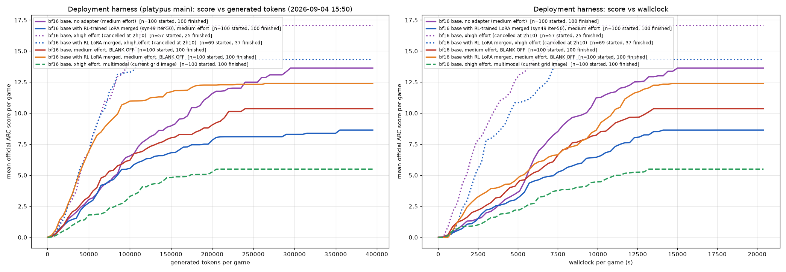
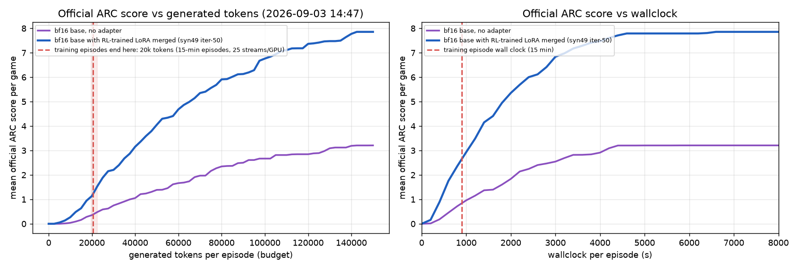
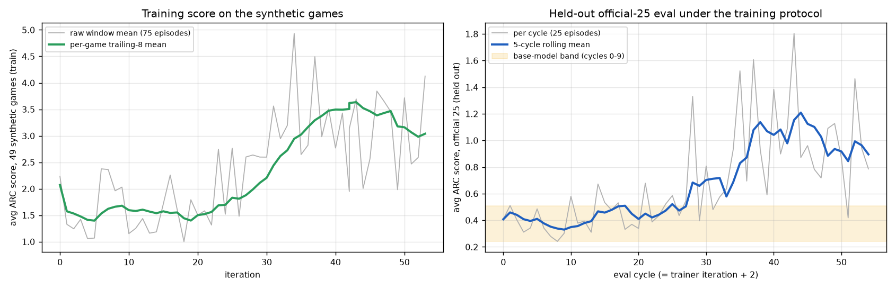
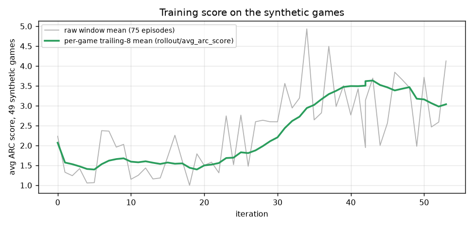
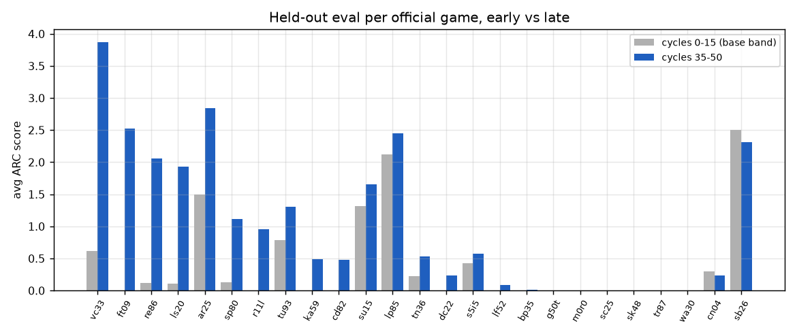
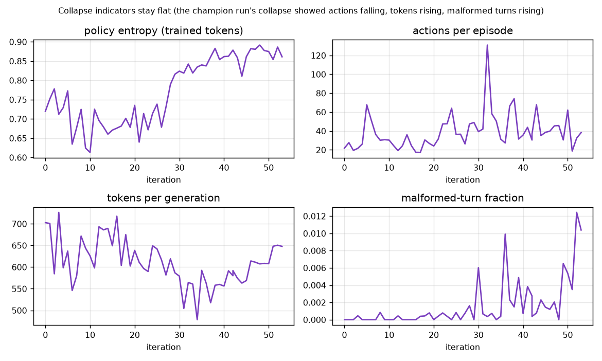

# Transfer run 2026-09-02: 49 synthetic games in, the 25 official games held out

**Headline.** Training the base model with PPO on 49 synthetic re-arc-3 games only, the
held-out score on the 25 official ARC-AGI-3 games rose from the base model's 0.36 to
1.05 (10-cycle means, same protocol as training) within 50 iterations, with no sign of
the drift that collapsed the previous 8-GPU run. This is the first evidence in this
repo that RL on synthetic games transfers to the official games. Under the deployment harness on platypus
main the same checkpoint trails the base while the harness's recurrent-state blank is on,
and is 2 points ahead (not significant) with the blank off (section below).

Run: `/data/personal/$USER/training_runs/20260902_112303_platypus_synthetic49_heldout25_8gpu`
(kander), config [`configs/ppo_8gpu_arc3_synthetic49_heldout_official25.json`](../configs/ppo_8gpu_arc3_synthetic49_heldout_official25.json),
Slurm jobs 2446902 (2026-09-02 15:31 → 03:25) and 2479167 (auto-relaunch, resumed
from iteration 42). Frozen source snapshot `ce2bb6e9959b` = trainer commit `dc5bc9d`
on `feat/platypus-training`; harness = arc3-platypus `training-harness-fixes` @ `099bc7a`
(vLLM 0.25.1). Status at the time of writing (2026-09-03 06:00): iteration 50, running.

## Setup

| | |
|---|---|
| Policy | `Qwen/Qwen3.8-27B` @ `1d4bf0f2`, LoRA r=16 α=32 on q/k/v/o, GDN in_proj_qkv/z + out_proj, gate/up/down; bf16; flash_attention_4 |
| Node shape | 1 × 8 B200: 3 vLLM rollout servers (GPUs 0-2), trainer `cuda:3` + 3 DDP ranks (GPUs 4-6), 1 vLLM eval server (GPU 7) |
| Training games | the 49 synthetic games of the SFT `filtered49` set (re-arc-3 package, `generator=manual`, all `codex-reviewed`); list in the config |
| Window | 75 episodes = every game once + 26 random repeats, 25 in flight per server, dealt so a repeat never lands on the same server |
| Episode protocol | 15-minute wall clock, temperature 1.0, 32k context, `agent_malformed_retries = 0`, malformed turns accepted as the model's own turn (`format_break` step) |
| Rewards | official per-level score deltas only (no format/tool shaping, both penalties 0); hidden-state critic + GAE; `loss_aggregation = token_mean`; reference-KL off |
| Optimizer | lr 5e-6, 40 warmup steps, one optimizer pass per window; startup + per-window logprob parity gate |
| Held-out eval | separate process on GPU 7: the 25 official games, one episode each per cycle, **identical protocol** (15 min, T=1.0, 32k, no retries), hot-loading the newest adapter; one cycle ≈ 16 min, so cycle *c* scores adapter *c−2* |
| Segments | 12 h, auto-relaunch (`ARC3_AUTO_RELAUNCH=1`), resume from the last checkpoint |

Depth note: with 25 streams per GPU each episode gets ~20–23k generated tokens
(30–37 generation rounds) in its 15 minutes; the champion run's 6–7 streams per GPU
gave ~50k. The held-out numbers below are therefore *not* comparable to the champion's
base-model 1.09 (which had twice the budget); the base band under this protocol is
0.24–0.51.

## Deployment-harness eval (platypus main): the gain shows only with the recurrent-state blank off

The same merged checkpoint and the same bf16 base, run through the deployment
harness on arc3-platypus `main` (38e4852: in-process vLLM fork 0.27.2, fp8 KV cache,
90k window, 32k reply cap, kernel and analyzer tools, recurrent-state blank on;
`demo.ipynb` flow with the model path swapped), 25 official games × 4 passes, 32
concurrent games, 12 h walltime, one B200 per arm. Compared with the latest
shared baseline `arc_3_results/shared/baseline_main_38e4852e` (Qwen3.8-27B-FP8, xhigh
effort, same recipe) using the TAAF `compare-runs` skill; the comparison tree is
`arc_3_results/shared/deploy_eval/20260903_142607/compare_with_baseline/`.



| arm (official ARC, mean ± SEM over 4 passes) | score |
|---|---|
| shared baseline: Qwen3.8-27B-FP8, xhigh effort | 16.09 ± 0.74 |
| bf16 base, medium effort | 13.63 ± 1.16 |
| bf16 base with RL-trained LoRA merged (syn49 iter-50), medium effort | 8.64 ± 0.83 |
| bf16 base, xhigh effort, multimodal `current_grid` | 5.49 ± 0.87 |
| bf16 base, medium effort, **blank off** | 10.36 ± 1.72 |
| bf16 base with RL-trained LoRA merged (syn49 iter-50), medium effort, **blank off** | 12.39 ± 0.99 |

Paired permutation test on per-game differences: base versus RL at medium effort
p = 0.024 with the base ahead by 5.0 points (48 games to the base, 34 to the RL
checkpoint, 18 ties); base-medium versus the FP8 baseline p = 0.42; RL-medium versus
the baseline p = 0.005. A first pair at xhigh effort (the deployment default) was
stopped after 2 h 10 to free the GPUs for the medium pair; over its first 50 games the
two arms were level (15.4 versus 15.2) with identical reply lengths (median 544 versus
555 generated tokens per LLM call).

Reading: the 2.4–3.2× lead on our own protocol does not carry over. At xhigh effort
the RL weights make no measurable difference; at medium effort, the effort the policy
was trained at, they hurt: the RL checkpoint reasons shorter (median 1120 versus 1398
tokens per call), takes more actions per call, and gives up earlier on the deep
levels, with four games (lp85, ft09, cd82, r11l) carrying most of the gap. The
training signal rewarded exactly that early-stopping style in 20k-token episodes. The
current-grid image also costs the base model heavily on this harness. bf16 versus
FP8 weights is not settled here: the only like-for-like bf16 arm (xhigh, text only) is
the partial one, at 17.1 over 57 games against the baseline's 16.1.

Blank off (the recurrent-state blank changes the reasoning style,
and the RL rollouts never saw it): the same medium-effort pair rerun with
`zero_recurrent=False`. The order flips. The RL checkpoint is 2.0 points ahead of the
base (52 games to the RL checkpoint, 35 to the base, 13 ties; 259 versus 206 levels),
not significant (paired permutation p = 0.26, bootstrap CI −5.0 to +1.0), while the blank
itself is worth 3.3 points to the base (blank on versus off, p = 0.08 on the permutation
test, bootstrap CI +0.4 to +6.6). So the deficit at medium effort is a property of
evaluating a policy trained without the blank under a harness that applies it, not of the
weights as such; with matching settings the RL checkpoint holds its own but does not
reproduce the 2.4–3.2× lead of our own protocol. Comparison tree regenerated with all six
runs.

## 150k-token eval: base versus the RL-trained checkpoint

The transfer checkpoint (iteration 50, the best surviving adapter by held-out
eval, merged into the bf16 base weights) and the untouched bf16 base were both
evaluated with the recipe that scored the champion (8 × 1-GPU jobs, seeds
1000–1007, every game of the official 25 in flight per job, **150,000 generated
tokens per game as the only limit**, temperature 1.0, 64k context compacting to
32k, no retries; `configs/eval_8gpu_arc3_ctx64k.json`, `scripts/eval_lora_single.sbatch`
with `ARC3_SERVER_MODEL_OVERRIDE` pointing at the merged checkpoint). Every
(game, seed) episode is played once in each arm, so the two curves share the
same grid of 200 episodes.



| generated tokens per episode | bf16 base, no adapter | bf16 base with RL-trained LoRA merged (syn49 iter-50) |
|---|---|---|
| 25k | 0.59 | 1.89 |
| 50k | 1.39 | 4.05 |
| 75k | 2.16 | 5.56 |
| 100k | 2.67 | 6.76 |
| 125k | 2.89 | 7.42 |
| 150k (final) | 3.21 | 7.86 |

Base arm: 196 of the 200 episodes ran to the 150k-token budget; the last 4 were stopped after 4 h of wallclock (29.5M of the arm's 30.0M token budget spent) and count with the levels they had completed by then. RL arm: 199 of 200 ran to the budget, the last one stopped the same way.

Reading: at every budget the RL-trained model scores 2.4–3.2× the base it was
trained from, and its lead is already there at the 20k tokens the training
episodes end at (dashed line). The same checkpoint does not reach the champion
(11.79 on this protocol, trained on the official games directly): it takes a
fifth of the champion's actions per episode (344 vs 1832; 1.9 vs 7.1 actions per
generation) and so completes the first levels efficiently but rarely reaches the
deep levels that carry most of the level-weighted score. Two thirds of the
synthetic training games make actions scarce (explicit action/step budgets), and
a 20k-token episode never rewards the exploratory multi-action play that pays off
between 50k and 150k tokens. Merged checkpoint: `/data/personal/$USER/merged_checkpoints/syn49_iter50_bf16`;
episodes under `/data/personal/$USER/eval_runs/20260903_syn49iter50_merged_150k_s*`
and `20260903_base_bf16_150k_s*`.

## Results



| iterations / eval cycles | training score (trailing, 49 games) | held-out eval (official 25) | held-out levels/episode | entropy | actions/episode | tokens/generation | malformed fraction |
|---|---|---|---|---|---|---|---|
| 0-9 | 1.60 | 0.36 | 0.18 | 0.71 | 33 | 639 | 0.000 |
| 10-19 | 1.54 | 0.46 | 0.20 | 0.68 | 25 | 654 | 0.000 |
| 20-29 | 1.76 | 0.57 | 0.25 | 0.72 | 41 | 613 | 0.000 |
| 30-39 | 2.93 | 0.88 | 0.34 | 0.84 | 55 | 548 | 0.003 |
| 40-49 | 3.47 | 1.07 | 0.35 | 0.87 | 41 | 588 | 0.002 |
| 50-54 (running) | 3.06 | 0.90 | 0.32 | 0.87 | 38 | 639 | 0.008 |

The eval is 25 episodes per cycle at temperature 1.0, so single cycles swing by ±0.5;
read the 5-cycle rolling mean (blue). Training score is the per-game trailing-8-window
mean; the raw window mean (`rollout/avg_arc_score_sampled`, grey below) has a standard
deviation of 0.76 across windows because one game (`cross_press`, 39 per episode on
average, 8–58 per window) carries a third of all reward mass.



### Per official game



| game | score cycles 0-15 | score cycles 35-50 | levels 0-15 | levels 35-50 | scored in late cycles |
|---|---|---|---|---|---|
| vc33 | 0.62 | 3.72 | 0.56 | 1.24 | 88% |
| ft09 | 0.00 | 2.69 | 0.00 | 0.47 | 35% |
| re86 | 0.12 | 2.42 | 0.06 | 0.82 | 71% |
| ls20 | 0.11 | 1.66 | 0.06 | 0.47 | 47% |
| ar25 | 1.50 | 2.85 | 0.69 | 1.06 | 94% |
| sp80 | 0.13 | 1.03 | 0.06 | 0.29 | 29% |
| r11l | 0.00 | 0.84 | 0.00 | 0.18 | 18% |
| cd82 | 0.00 | 0.56 | 0.00 | 0.12 | 12% |
| tu93 | 0.79 | 1.21 | 0.44 | 0.76 | 76% |
| tn36 | 0.22 | 0.63 | 0.06 | 0.18 | 18% |
| ka59 | 0.00 | 0.37 | 0.00 | 0.12 | 12% |
| dc22 | 0.00 | 0.28 | 0.00 | 0.06 | 6% |
| su15 | 1.32 | 1.59 | 0.62 | 0.82 | 82% |
| lp85 | 2.12 | 2.39 | 0.94 | 0.88 | 88% |
| s5i5 | 0.43 | 0.65 | 0.25 | 0.35 | 35% |
| lf52 | 0.00 | 0.11 | 0.00 | 0.06 | 6% |
| bp35 | 0.00 | 0.02 | 0.00 | 0.06 | 6% |
| g50t, m0r0, sc25, sk48, tr87, wa30 | 0.00 | 0.00 | 0.00 | 0.00 | 0% |
| cn04 | 0.30 | 0.28 | 0.06 | 0.06 | 6% |
| sb26 | 2.50 | 2.22 | 0.94 | 0.82 | 82% |

Twelve games improved, six stayed at zero, the games the base model already solved
(lp85, sb26, su15) held. Eight games that the base model never scored on now score
(ft09, r11l, cd82, ka59, dc22, lf52, bp35 and, with a large margin, re86).

### Stability



The champion run's collapse signature was actions per episode falling, tokens per
generation rising, malformed turns rising, entropy falling. Here entropy rises
(0.71 → 0.87), tokens per generation are flat, the malformed-turn fraction stays ≤ 0.01
(alarm at 0.02; a slow creep from 0.000 to ~0.005 after iteration 30 is the one thing to
keep watching), clip fraction 0.001–0.003, PPO ratio 1.00, parity gate passing on every
segment (mean |Δlogp| 0.013 at start, 0.0035 on resume). The `collapse watch` warnings in
the log from iteration 9 on are a false alarm of the frozen code's max-based rule (one
spiky window at iteration 5); the rule now uses the trailing median (`4cb482e`).

### The two 2-GPU arms on the official 25 (direct training)

Same reformed recipe, training directly on the official 25 on one server GPU, for
comparison with the champion recipe's history: control (no shaping) at iteration 70,
score 0.73 → 1.69, entropy 0.89; noretry (penalties on) at iteration 75, score
0.88 → 1.50, entropy 0.89. Both are past the iteration range where the champion began
to drift, with no drift.

## Code

Trainer branch `feat/platypus-training` (PR #72), commits since the champion run that
this run depends on:

| commit | what |
|---|---|
| `a83ace0` | rejected attempts become training data and metrics; `token_mean` loss aggregation |
| `e56fe8c` | no hidden retries in training; the harness reports malformed turns as `format_break` steps |
| `f57411c` | one estimator, no legacy shims, stability defaults, reference-KL anchor, collapse watch |
| `2749f8d` | no reward shaping by default; rewards are the official per-level score deltas |
| `c7e1701` | the startup parity gate fails on systematic mismatch, not one deep-tail token |
| `dfbe88d`, `7842617`, `e35f925` | the synthetic-49 recipe with the official 25 held out under the training protocol; 8/5/4-GPU shapes; held-out eval servers launched by the sbatch |
| `f5dc121` | `accept_malformed_output` rides the worker spec; per-window game subset is opt-in |
| `625b339`, `1b26740`, `82e25c3` | 25 episodes per training server; windows larger than the game list repeat random games, spread over servers |
| `464fb98`, `0e13d69` | auto-relaunch honours `NEXT_TIME_LIMIT`; a hand-submitted continuation can take over a chain |
| `dc5bc9d` | the held-out eval worker keeps its serve dir under a durable root (was crashing every third cycle) — the run's frozen source |
| `4cb482e` | collapse watch compares actions per episode with the trailing median, not the peak |

Harness branch arc3-platypus `training-harness-fixes` (the venv the servers and the
rollout worker run from; PR #74 closed, to be reopened with this result):

| commit | what |
|---|---|
| `ccd1b00` | `ULLM_PROXY_INACTIVITY_S` overrides the proxy stall watchdog |
| `25afb28` | eval: malformed-exhaustion gives up gracefully; env-tunable OAI connect timeout |
| `2078732` | ullm/duck: a malformed reply can be accepted as the model's turn; duck `malformed_retries` knob |
| `099bc7a` | `accept_malformed_output` is agent configuration; malformed marker on every trace record kind; design doc |

Launch (from the trainer checkout, snapshot taken at first boot):

```bash
ARC3_CONFIG=configs/ppo_8gpu_arc3_synthetic49_heldout_official25.json \
ARC3_RUN_DIR=/data/personal/$USER/training_runs/20260902_112303_platypus_synthetic49_heldout25_8gpu \
ARC3_PLATYPUS_VENV_OVERRIDE=/home/$USER/scratch_platypus_pr69/.venv \
ARC3_AUTO_RELAUNCH=1 \
sbatch --job-name=arc3-syn49-heldout25-8gpu --gres=gpu:b200:8 --time=12:00:00 --exclude=dgx02 scripts/platypus_debug_smoke.sbatch
```

## Checks

**Cross-contamination of the training games.** The 49 training games come from the
re-arc-3 package (`re_arc/environment_files/<game>/0001`). None carries the `official`
or `official-reimplemented` tag; all are `generator=manual` synthetic games. Their seeds
(22 from `compact_axis_seed_ideas_20260805.json`, 27 from the GPT-5.6 Pro
"short games" specification batch) do not name any official game, and the spec prompt
asks for "a completely original game". The manifests' mechanic taxonomy has essentially
no overlap with the 11 official reconstructions in the package (max Jaccard 0.12 on
generic tags such as `timer`). Reading the designs against the 25 official descriptions
(`docs/arc_official_description` in re-arc-3), the following share a mechanic *family*
with an official game, though none reproduces its rules or levels:

| synthetic | official relative | relation |
|---|---|---|
| twin_shadow | m0r0 Mirrored | two linked avatars with mirrored horizontal control and plate-gated goals — the closest pair |
| cross_press, contact_alchemy | ft09 Flip Tiles | click-to-toggle tiles with neighbour side effects (Lights-Out family) |
| color_ferry, pressure_relay | ls20 Locksmith | carry a mutable colour/key state through gates |
| balanced_reservoirs, charge_pour | vc33 Valvecheck | reservoir-to-reservoir transfers with conservation |
| chromatic_clock, pinwheel_tiles | lp85 Looping Chains | click-advanced cyclic positions with coupled objects |
| anchor_ice, stone_skaters, crate_caps | wa30 Warehouse | push/carry crates onto targets |
| floodline | sp80 Spill | water spread against built barriers |
| stepstack, falling_scaffold | bp35 Bottomless Pit | side-view gravity puzzles |

The held-out gains do not follow that table: the two closest pairs transferred nothing
(m0r0 and wa30 stay at 0.00), while re86, ar25, r11l, cd82, tu93, tn36, ka59 and dc22,
which have no synthetic relative, improved. ft09, vc33 and ls20 did improve strongly and
do have relatives, so a clean ablation is worth running: the same recipe without the
twelve games in the table (37 games), read on the same held-out eval.

**`rollout/avg_arc_score_sampled` dips.** That series is the raw mean of the current
window's 75 episodes; `rollout/avg_arc_score` is the per-game trailing-8-window mean.
With one game worth a third of the reward mass, a window in which its one or two
episodes score low pulls the raw mean down by ~1 without any change in the policy; the
trailing metric, the eval, entropy and the action/token statistics show no dip.

## Side experiment: FP8 rollouts

Branch `exp/fp8-consistent` (separate clone, `scripts/fp8_exp/`, `training/fp8_mirror.py`,
`training.fp8_consistent`, `ARC3_SERVER_MODEL_OVERRIDE`), 2-GPU standalone jobs, no
training run touched. FP8 W8A8 rollouts give +17% (25 streams) / +22% (8 streams)
tokens per second, but the sampler/trainer logprob mismatch doubles (0.021 → 0.044 mean
|Δ|) and cannot be closed by an FP8-mirror trainer: per-token activation quantization
turns kernel-level bf16 differences into FP8 rounding flips. Weight-only FP8 (W8A16) is
exactly consistent (0.015 with the dequantizing mirror) but not faster at 25 streams
(−17%). N-gram speculative decoding is 2× slower on grid text and its reported logprobs
are wrong under vLLM 0.25.1 (0.33). Under the no-mismatch rule FP8 buys nothing on this
stack; the levers for more tokens per episode stay fewer streams per GPU or TP=2.

## Next

1. Let the run go (45 iterations per 12 h segment) and read the held-out trend at
   iteration 100; pin adapters 40/50/60 for a deployment-protocol eval (150k tokens).
2. Depth: 8 streams per server (24 episodes per window) to restore the champion's
   ~50k tokens per episode; the held-out number then becomes comparable to 1.09.
3. The 37-game contamination ablation above.
4. Reopen the arc3-platypus PR with this result.
