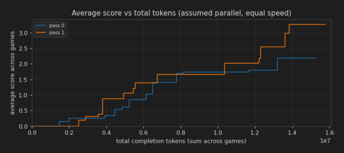
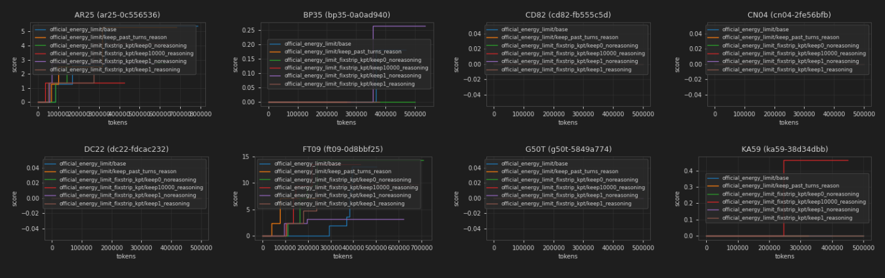

# Requirements for ARC-AGI3 orchestration framework

This document lays out requirements for a Tufa ARC-AGI3 framework (TAAF) for solvers developed by Tufa Labs.

Why do we need such a framework?
- Clear contract of what a solver is - this allows us to also build metasolvers such as a hybrid solver that selects a suitable solver per game
- Consistent definition of benchmarks (which games, how long, which environment, ...)
- Abstraction of `arcengine` concepts like environments to simplify interaction and to create more design space for synthetic games
- Easy running of solvers in any environment (Tufa cluster, Kaggle including submission, ...)

Design summary:
- A `Benchmark` (section 2) ties together a `Solver` (section 12), a list of `Game`s (section 11), and a number of passes. `Benchmark.run()` plays the games; `Benchmark.deploy()` packages and dispatches the run to a target environment (inline, Tufa cluster, Kaggle interactive, or Kaggle submission).
- The `Solver` interface is intentionally minimal — `setup()` plus an async `run_games(list[Game])`. Concurrency, error isolation, and free-form solver-internal diagnostics are the solver's problem, not the framework's.
- `Game` is abstract; `GameAPI` is the ARC-AGI3-environment subclass. `GameRun` accumulates framework-level state per game (history, score, token counts).
- Multiple passes are realized by handing several copies of each game to the *same* solver instance simultaneously.
- Outputs of a run include per-run HTML diagnostics, a JSON-serialized `Benchmark` (saved every 10 minutes during the run), a brief text summary, and optional solver trace folders (section 5).
- Diagnostics include token cost analysis (if the solver provides this information), and functionality to compare different solvers to each other.
- Trace collection standardizes solver/model-call data for training, but solvers remain responsible for deciding what to trace.

Directory locations:
- **`Benchmark.job_dir` / job directory** is the durable run directory for normal benchmark artifacts (`benchmark.json`, diagnostics, summaries, logs, deployment metadata, source snapshots). It is supplied by the user for inline/Tufa cluster runs, typically under durable storage such as `/data/...`; on Kaggle it is `/kaggle/working/`.
- **Trace root** is where raw trace folders are written. By default it is `Benchmark.job_dir/traces/`, but trace-heavy jobs may set it separately, typically on node-local scratch such as `/scratch/jobs/$SLURM_JOB_ID/.../traces/`.


Some short notes on how this document should be read:
- This is not a wishlist; the framework will fulfill all requirements completely. If this is not feasible, we discuss and change the requirements.
- Requirement numbers are designed to remain consistent even if we change requirements; that is why sometimes section and requirement numbers are skipped.
- Some requirements are marked (T) - this means they are required to be tested as part of the continuous-integration flow (see R1.3).
- All requirements are bold text. Any other text is rationale and explanation that is not part of the requirements.

## 1. General

**1.1 TAAF shall be in a separate repository on github.com/tufalabs.**

**1.2 TAAF shall provide a `makefile` with standard commands.**

We can list these out, but I'll just point to the `makefile` in `re-arc-3` as a good example.

**1.3 TAAF shall include automatic testing (included in the commit flow), covering at least all requirements marked (T), and taking no more than 5 minutes.**

**1.4 (T) TAAF shall pass formatting, linting, and type checking with no errors or warnings, using `ruff format`, `ruff check` (including import sort), and `pyright`.**

**1.5 TAAF shall not import `vllm` or any GPU-using library such as `torch`.**

Rationale: solver may need to set environment variables before such a package is imported for the first time.

## 2. Running and deploying benchmarks

Note that the term 'benchmark' is used for running a defined sequence of games in a defined setting. This could be a true benchmark in the sense of getting a hard performance number, but also simply an experimental run. Whenever we run a solver (including Kaggle submission), it will go through this benchmark concept.

**2.1 TAAF shall provide a `Benchmark` class that orchestrates running several games for a given solver. It shall take as input via class properties:**
- **A label.**
- **A list of `Game` (section 11).**
- **A `Solver` (section 12).**
- **A number of passes to run.**
- **A job directory.**

Environment-specific knobs (wall-time budget, CPU count, memory limit, GPU type, partition, container image, …) live on the corresponding `DeploymentTarget` subclass (R2.21), not on `Benchmark`. A single benchmark deployed to two different environments uses two different targets, each carrying its own env-relevant config.

**2.2 (T) When running multiple passes, `Benchmark` will simply send several copies of each game to a single solver simultaneously.** (So no separate solver copies)

Note that the copies shall be played independently: no copy's play may depend on what another copy saw or did. Solvers may, however, read `GameRun.pass_index` (R11.02) to tell the copies apart — assigning each pass its own configuration is how a parameter sweep shares one solver run, and one served model, across several configurations.

Diagnostics' per-pass statistics (section 4: per-pass means, σ across passes, SEM, head-to-head t-tests) assume every pass ran the same configuration. A solver that varies configuration by pass invalidates those figures for its own runs; interpreting such a run is then the experiment's business, not TAAF's.

**2.11 (T) `Benchmark` shall provide a `run` function that runs the solver on all games.**

**2.12 (T) The `run` function shall take as optional input `soft_end_time` as a UTC time stamp. When this time is reached, it cancels the solver via `task.cancel()`.**

This gives the solver time to exit gracefully, for example storing diagnostics. As specified in R2.32, `deploy` sets it to 10 minutes before the environment itself shuts down. Note that the `run` function does not care about the maximum runtime specified in the class; that's for deployment as specified below.

**2.13 (T) Every ten minutes and after finishing, `run` shall save the `Benchmark` to a JSON file in the job directory (including all `GameRun` objects, see R11.02), and generate all diagnostics as specified in section 4. None of this shall be done during Kaggle submission. A `Benchmark` may leave the diagnostics page and its movies to the save after finishing (`periodic_page`): rendering them holds the event loop that serves the games.**

This regular saving is just so we can check in on an ongoing job. It won't enable resuming from a failed job.

**2.14 (T) The `Benchmark` class shall include an import method that reconstructs the full class except the game list from the JSON described in R2.13.**

**2.15 (T) `run` shall finish gracefully even if the solver errors out.**

### Deployment

> **Implementation status note.** Inline (R2.22), Tufa cluster (R2.23), and Kaggle notebook deployment (R2.24/R2.25) targets are implemented. The Kaggle path prepares/uploads a notebook plus source dataset; final competition submission remains a manual Kaggle UI action.

**2.21 (T) `Benchmark` class shall provide a `deploy` function that sets up and runs the benchmark (via `run`) in a specified environment.**

Note that we call `deploy` on a `Benchmark` instance set up in Python, not on e.g. a YAML file. How to get the `Benchmark` to the environment is a design decision not specified here, but one possible way is to pickle it and store it in the job directory/Kaggle dataset.

The remainder of this section specifies the various environments and the general functionality of `deploy`. Not all functionality applies in all environments, as specified in this table:

|                                                               | R2.22 Inline | R2.23 Tufa cluster | R2.24 Kaggle                                              | R2.25 Kaggle (emulating) submission |
| ------------------------------------------------------------- | ------------ | ------------------ | --------------------------------------------------------- | ----------------------------------- |
| R2.31 Actions needed apart from running `deploy`              | None         | None               | Runs automatically on push; collect outputs (or cancel)   | Submit, check score                 |
| R2.32 Cancel signal sent to solver 10 minute before hard stop | Yes          | Yes                | Yes                                                       | No                                  |
| R2.33 Graceful stop mechanism                                 | Yes          | Yes                | No                                                        | No                                  |
| R2.34 Unique job directory                                    | Yes          | Yes                | Yes                                                       | Yes                                 |
| R2.35 Source code for tufalabs repositories in job directory  | Yes          | Yes                | No                                                        | No                                  |
| R2.36 Pipe solver stdout and stderr to files in job directory | Yes          | Yes                | Yes                                                       | No                                  |
| R2.37 Run in unique venv                                      | Yes          | Yes                | No                                                        | No                                  |
| R2.38 Run in specified container                              | No           | Yes                | No                                                        | No                                  |

**2.22 (T) Inline environment: `deploy` shall support running directly inline (without creating a new environment).**

This is for running typically quick tests in an interactive SLURM job. Note from the table that it still runs isolated, i.e. makes its own job directory outputs, own venv, etc. This also makes it an efficient test of the framework, useful especially when SLURM queues are long.

**2.23 Tufa cluster environment: `deploy` shall support queuing as a new SLURM job on the Tufa cluster, including specifying which GPU (B200/B300) or CPU-only. The target shall accept CPU count and memory limit as configuration.**

This is intended to be the workhorse for structural experimentation.

**2.24 Kaggle environment: `deploy` shall support deploying on Kaggle, creating a new version of a specified notebook that is set up to be executed online or submitted immediately (the same notebook for both).**

What changes in submission can be seen in the table above, as well as these items spread throughout this document:
- R2.13: no periodic JSON save during the run, and no in-run diagnostics generation.
- R4.01: no HTML diagnostics file is written.

Note: on Kaggle, `deploy` pushes the notebook with `kaggle kernels push`, which **also runs it** — Kaggle executes the committed version on push, and there is no push-without-run in the Kaggle API. So outside `dry_run`, `deploy` launching the run is unavoidable; an unwanted run has to be cancelled from the Kaggle UI. (Only the competition *submission* to the leaderboard, R2.25, remains a separate manual step.)

**2.31 (T) `deploy` shall perform the following in the specified environment (details and exceptions per environment below):**
1. **Set up the environment to be able to run the benchmarks (for example: install packages on Kaggle).**
1. **Output general info to stdout/notebook output, including at least:**
    - **`Benchmark` label.**
    - **`Solver` `repr`.**
    - **Git commit ID of all tufalabs repositories, and if they're clean.**
1. **Run the benchmark.**
1. **Provide a brief summary to stdout/notebook output including scores and # of levels beaten.**
**On Kaggle, `deploy` pushes the notebook and Kaggle runs it automatically (the push executes it — see R2.24); the only manual Kaggle step is submitting a run to the competition leaderboard (R2.25). For all other environments the above is fully automated.**

**2.32 `deploy` shall ensure we never hit a hard timeout in the environment; rather, it uses `soft_end_time` on `run` to ensure the solver exits gracefully in time, setting this to 10 minutes before the actual kill time. This is not done during Kaggle submission; that gets a hard timeout.**

Note: "actual kill time" must be derived from the live job rather than precomputed at submit time. On SLURM, this means querying the job's start time + requested wall time at the moment `run()` begins, so that delays in environment setup (uv sync, package install, engine load) are correctly subtracted from the soft deadline. Precomputing at submit time would burn the entire setup phase out of the solver's budget.

**2.33 (T) `deploy` shall provide a mechanism for gracefully stopping a deployed benchmark, except on Kaggle.**

This means we can interrupt a benchmark, but still ensure the solver and benchmark exit gracefully, storing all diagnostic outputs for example. An example implementation is a killswitch file, or a high SIGINT buffer on a SLURM job.

**2.34 (T) `deploy` shall use the job directory specified in the benchmark for all framework input and output files, except for explicitly configured trace roots as described in R5.46. On Kaggle, this will always be overridden by `kaggle/working/`.**

**2.35 (T) Every editable repository in the launcher's venv shall be included in the job directory, except on Kaggle. Each per-repository snapshot shall contain:**
- **`pyproject.toml`.**
- **`README.md`.**
- **The importable package source tree(s) declared by the project's package configuration.** (This is typically `src/`, but may be other directories — for example `re-arc-3` declares `re_arc/` and `pipeline/`.)

"Editable" is determined per PEP 610 (`*.dist-info/direct_url.json` with `dir_info.editable == True`). The rule is environment-agnostic: every editable install the launcher had is what the worker venv must be able to install editable too, so that `.run()` and `.deploy()` see the same package set.

**A repository that is a uv workspace is bundled as ONE snapshot rooted at the workspace root — root `pyproject.toml` and `uv.lock` plus every member at its workspace-relative path. An editable install of any member triggers bundling of the whole workspace (a member's `{ workspace = true }` sources are meaningless outside it). On Slurm the worker detects a workspace `main_project` from its bundled pyproject and syncs with `--all-packages`; on Kaggle every member's source tree joins `sys.path` alongside the repo-level entries.**

**Non-editable distributions installed from a `github.com/Tufalabs` repository shall additionally be bundled as their installed importable package tree(s) — at the resolved commit — so offline targets (notably Kaggle) can import them without a package index. These carry only package code (no `pyproject.toml` / `Makefile`), so such a bundle cannot serve as a Slurm `uv sync` `main_project`; the project a run is launched from is expected to be the editable one. Standard (non-Tufa) PyPI dependencies are left to the target's own install. A target whose worker resolves its dependencies itself from the bundled `main_project`'s lock (Slurm) may leave these installed-package bundles out, since it never reads them.**

**A target shall accept an explicit exclusion list, naming repositories to keep out of its own bundle. This is the one opt-out from the discovery above, and it exists for a repository the worker obtains by other means: the Kaggle runner prepends every bundled repository to `sys.path`, so a bundled copy of a package the worker also installs shadows the installed one rather than merely costing space. Exclusion is per target — the discovery itself stays automatic, and a repository excluded from one target's bundle is still bundled for another.**

Rationale: this makes it very easy to figure out what's going on. For example, for a weird result you can ask your favorite agent to analyze the source code diff between two runs. Auto-discovery removes a foot-gun — a user-maintained "extra repos" list silently diverges from the launcher venv the moment someone adds a new editable dep and forgets to update the deploy call.

**2.36 (T) In all environments except submission, `deploy` will ensure the stdout and stderr outputs are piped to a file in the job directory.**

**2.37 (T) `deploy` shall create a unique venv for every run except on Kaggle.**

**2.38 `deploy` shall optionally allow a container to be specified for the 'Tufa cluster' environment.**

**2.39 `deploy` shall write a metadata file in the job directory recording, for each environment, enough information to identify and reattach to the running job (e.g. the SLURM job ID for the 'Tufa cluster' environment). The filename is not mandated; the framework reads this file when reattaching to a previously-launched deployment.**

This is what lets a user whose Python launcher process has died (or moved to a different machine) reconstruct a `DeploymentHandle` for an in-flight job and resume monitoring / stopping it. Concretely TAAF writes a single `deploy_meta.json` in the job directory — one file across all targets keeps `attach()` simple and prevents the single-purpose-file proliferation a per-target file would invite.

The remainder of this section specifies several more requirements specific to the Kaggle environment.

**2.51 (T) Kaggle submission environment: The created notebook shall have a flag `RUN_AS_SUBMISSION`; if True, it will behave as in submission. If actually in submission this will be set to True automatically. This setting shall be made available to the solver.**

The solver may reduce its logging based on this setting.

**2.52 (T) The created notebook shall have the RTX6000 GPU selected and Internet access disabled.**

**2.53 (T) The user can specify which notebook on Kaggle to create/update, but by default a per-user notebook is created or updated.**

**2.54 (T) The importable package source tree(s) declared by the project's package configuration for each Tufa Labs repository shall be included as a dataset, automatically uploaded and attached to the notebook. The user can specify which dataset to use, but by default a per-user dataset is created or updated.**

Per-user notebook and dataset means that every Tufa employee has their own notebook and dataset (rather than messing with each other's data).

The dataset holds the bundle as a single archive, which the notebook unpacks to local disk: a dataset of many files is slow to attach, and Kaggle unpacks an uploaded `.zip` into its files, so the archive is named otherwise (2026-10-27).

**2.55 (T) The solver may specify additional datasets by their Kaggle URL, which shall then be attached to the notebook.**

**2.56 (T) The Kaggle notebook shall ensure necessary packages (such as Tufa repositories and vllm) are on the path before the solver is loaded from its pickle. TAAF shall provide a mechanism for the solver to specify such packages.**

**2.57 (T) TAAF shall define a special benchmark consisting of 110 game runs, repeating the 25 official games 4 or 5 times each. Despite running multiple passes, this special benchmark shall be compatible with the competition-simulating Arcade.**

Note that the use of this benchmark is not enforced; whatever set of games is selected will run in the Kaggle notebook.

**2.58 When truly in submission (i.e. not just RUN_AS_SUBMISSION True as in R2.51), we always switch in the test Arcade and list of games.**

**2.59 When RUN_AS_SUBMISSION is True, periodic writing of diagnostics (see chapter 4) shall be disabled. However, a brief text status update is still printed every 10 minutes. In addition, logging of intermediate game states shall be disabled.**

This is ideally implemented by some form of minimal_diagnostics flag also exposed to the solver (rather than checking for Kaggle mode + RUN_AS_SUBMISSION all over the code).

**2.60 The Kaggle notebook shall be 'nice', i.e. having a clear introduction and Markdown explanation of what it does.**

Rationale: we may end up making any submitted version public.

**2.61 (T) TAAF shall provide a public 'share' variant of the Kaggle deployment, selected by a `make_share_version` flag on the Kaggle target. The share variant shall:**
- **render a minimal, Kaggle-only notebook (`taaf_kaggle_run_share.ipynb`) carrying no `RUN_AS_SUBMISSION` emulation flag (R2.51) and no local-debug scaffolding. It branches solely on whether Kaggle reports a real competition rerun: in a rerun it plays the live competition Arcade; otherwise (an interactive Save & Run) it plays the competition's own bundled `environment_files` offline, so the public notebook is runnable end-to-end without a submission.**
- **exclude the `re-arc-3` snapshot (TAAF's offline env-files; R2.35) from its source dataset. The offline branch above reads the competition's own bundled env-files, never `re-arc-3`, so the exclusion holds on both paths.**
- **suffix the default kernel and dataset slugs with `-share`. Explicitly configured slugs are left unchanged.**

Rationale: a publicly shared notebook + dataset must not ship TAAF's offline ARC-AGI-3 env files, and must read cleanly (no emulation or local-debug scaffolding). It stays runnable interactively because the competition attaches its own env-files, which the offline branch reads instead of `re-arc-3`. The `-share` slug default keeps the public artefacts from colliding with a user's private working notebook/dataset.

**2.62 (T) On every Kaggle variant, `deploy` shall refuse to upload — raising an error — if the destination notebook or the destination source dataset is public on Kaggle, or if a public notebook is requested for it (`public=True`). This includes the share variant (R2.61): TAAF always pushes privately, and making an artefact public is a deliberate manual step taken after the run, so a public target at deploy time is treated as an accident. Visibility shall be read by an exact get-by-ref (not a search), so an existing public target cannot be missed. A destination that does not exist yet is allowed (created private by default, R2.52), so a first deploy proceeds; any other indeterminate visibility fails closed (refuse), with a hint.**

Rationale: the default source dataset bundles TAAF's private offline ARC-AGI-3 env files and the Tufa source snapshots (R2.35); pushing it into a publicly visible notebook or dataset would leak them. Because re-running `deploy` versions whatever notebook/dataset already lives at the target ref, an existing public artefact at that ref is just as dangerous as `public=True`, so both are blocked. For a leak guard the dangerous direction is a false *negative* (silently pushing to a public target): an exact get-by-ref avoids the false negative a paginated search could cause, and any *indeterminate* visibility fails closed rather than assuming safe. A not-yet-created target is the one exception where proceeding is safe — the deploy creates it private — and Kaggle reports a missing own resource as HTTP 403/404, which the guard treats as "not created yet" (as `_dataset_exists` already does). The share variant is not exempt: even though its bundle excludes the offline env files, TAAF still pushes it privately and publishes it manually later, so a public share target at deploy time is an accident to catch, not the intended state.

**2.63 (T) A benchmark shall be able to keep a run alive through a stretch with no moves, so an environment that ends idle runs does not end it before the solver plays. When enabled, TAAF sends a RESET to the first game that is on a level no action has touched whenever a configurable interval (10 minutes by default) has passed with no move on any game and no keepalive, counted from the last such action or, before the first, from when the environment started — on Kaggle, notebook start — so the gap between two engine actions never exceeds the interval by more than a short poll. The RESET shall be invisible to the solver: it is not recorded in the move history or the per-level action counts, and it leaves the state the solver sees unchanged, which is why only an untouched level qualifies. The number sent is recorded on the game run. It shall keep firing while the solver blocks the event loop (for example building an inference engine). Each RESET is logged to stdout. Off by default; the Kaggle notebooks turn it on when running as a submission (R2.51), and a user can turn it on for any run.**

Rationale: a Kaggle submission ends a run that goes 15 minutes without a move, and package install plus a solver's own startup can take that long. The engine counts each such RESET as an action on that level, so the affected game's engine score can sit below the framework's; R11.12 reconciliation is skipped for it.


**2.64 (T) A solver shall be able to end its own run early through the soft-deadline path. `Benchmark.stop_early(reason)`, reached by the solver as `Solver.stop_run` for the run's duration, cancels the solver task as the deadline does, so its games land `cancelled` and teardown writes everything, and `run` returns normally; the reason is recorded on the benchmark (`stop_reason`, in the JSON snapshot and the run summary) and printed.**

Rationale: a run whose engine has stopped producing is otherwise ended only by its budget, hours later, with nothing to read for it. The harness's own watchdog is what can see the stall, and it needs a way out that keeps the diagnostics rather than a crash.

**2.65 (T) The notebook's Kaggle image may be pinned by digest, named by the solver (`kaggle_docker_image`) or by the Kaggle target (`docker_image`); when both name one they shall agree, or `deploy` refuses. Unnamed, the image is Kaggle's current one.**

Rationale: a solver's offline setup is built for one image — a wheelhouse resolved on it, a recorded install replayed onto it — and Kaggle changes its current image without notice, so a kernel that does not name its image runs on whatever it is that day.

**2.66 (T) A benchmark shall be able to bring its solver up before anything reaches the games' environment (`startup_stealth`). When enabled, `run` awaits the solver's `start_up()` (R12.01) — bounded by the soft deadline and the stop paths, as play is — before it lists the games through an optional game source, opens any game, or starts the keepalive (R2.63). A `start_up()` that fails, or that the deadline or a stop ends, opens no game and raises out of `run` after teardown rather than finishing gracefully (R2.15); teardown calls the solver's `shut_down()`, which releases what `start_up()` brought up. Disabled (the default), the games open first and `start_up()` is never called. Both Kaggle notebooks enable it on every run unless the target turns it off (`KaggleTarget.startup_stealth`) — a run outside a submission then starts up as a submission does, and so tests it — and in a rerun hand the gateway's readiness wait and game listing to `run` as the game source. Turned off, the notebooks keep the order from before it: a rerun's games are listed before `run`, every game opens before the solver starts, and in a submission the keepalive (R2.63) RESETs through the start-up.**

Rationale: a Kaggle submission that has not touched the competition's API in its first 15 minutes errors out and is refunded, while one that has touched it is lost if its solver then never comes up — an engine whose checkpoint mount stalls the load, or a kernel that dies before it plays. Opening the games first commits the submission before the solver has shown it can play; bringing the solver up first turns a failed start into a refund. A good run's solver comes up well inside the window, so only runs that would have scored nothing are refunded (2026-10-25). The target can turn it off for a run without a startup deadline (R2.67): under stealth such a run's slow start-up meets the 15-minute rule with nothing opened and errors out, while with the games open first the keepalive carries it into play (2026-10-30).

**2.67 (T) Under `startup_stealth`, a run shall be able to set a startup deadline, measured from the environment's start as the soft end time is: if the solver is not up and ready to play by then, the process exits at once with a non-zero status, whether or not its output is being read, before any game is listed or opened. The deadline is enforced from a background thread armed as the solver starts up, so a start-up that blocks the event loop cannot hold it, and a deadline already past when it is armed fires immediately; a solver that comes up past it, before the thread has fired, raises instead. It is refused without `startup_stealth`, and on Kaggle a target that turns stealth off refuses every startup deadline at deploy. On Kaggle the target sets it (`startup_deadline_s`, and `submission_startup_deadline_s` for a submission) and both notebooks pass it, on every run; the target can also set one counted from when the machine booted (`startup_deadline_after_boot_s`, from `/proc/uptime`), and with both set the earlier applies; in a submission, a competition rerun or a run with `run_as_submission`, both are the target's submission ones (`submission_startup_deadline_s`, `submission_startup_deadline_after_boot_s`). Both notebooks print the machine's uptime at notebook start.**

Rationale: R2.66 makes a solver that fails to start cost a refund rather than the submission, but a solver that hangs — a load that never finishes — is ended only by the 15-minute rule, and a slow one may still be loading when it fires. A deadline under that window ends the notebook with certainty while nothing has been opened. Nothing about the exit needs to be orderly: no game is open, and the notebook's error is the result (2026-10-25). The deadline from machine boot exists because a Kaggle session has sat 6.7 hours on its machine before its container and notebook started (2026-10-26: at notebook start the container had been up 6 s, the machine 24071 s), a wait the deadline from notebook start cannot see; whether a submission's time limit counts that wait is unknown. It is a separate, longer allowance because a machine may already have been up a while when a session that starts promptly gets it: that one booted minutes before its kernel was pushed (2026-10-27). Its allowance depends on the mode because a machine may have been up long before the session was even submitted (2026-10-28: a session that started minutes after its push found its machine up 40 minutes, and a 20-minute allowance from boot ended it before its engine started): a submission's error out of startup is refunded, so it can be tight there, and any other run gets a long one (2026-10-28). The deadline from notebook start may differ by mode for the same reason: a session whose mounts read about a sixth as fast as usual was still loading its checkpoint 14 minutes in (2026-10-28).

## 4. Reporting and diagnostics

Key design choice: diagnostics in TAAF cover only the generic comparison between solvers. Solver-specific reporting remains the solver's responsibility. TAAF does, however, standardize a lightweight trace format and read/write helpers for solver/model-call traces used for training (section 5).

**4.01 (T) Each benchmark run shall write an HTML file, containing at least:**
- **A plot showing the score as a function of cumulative generated tokens, pretending all `(game, pass)` runs are independent lanes running in parallel at equal speed. The plot has a single pooled curve: x = mean tokens spent per lane, y = mean score per lane. Reading at `x = X` gives the expected score per game when the method runs at an average per-game token budget of X. (Decomposable arithmetic mean, so pooling all `(game, pass)` lanes is equivalent to averaging passes within game first, then games — the order doesn't matter when lane weights are equal.)**
- **The same plot, but as a function of wall-clock time: x = time since the benchmark started, y = mean score per lane at that moment. A lane scores 0 until its game has started, so games that queued for a slot enter late; the pooled-lane construction does not apply, since the lanes do not run in parallel at equal speed.**
- **A table with one row per pass per game, with game ID, pass number, score, level reached, number of actions, and number of generated tokens.**

Note that this HTML file must also be generated on Kaggle (not during submission).

The pooled-lane formulation has a clean budget interpretation that supports hybrid-method analysis (concave envelope of multiple methods at a fixed average budget).

Example of what the plot in the second bullet could look like (the example predates the pooled-lane formulation, but the qualitative shape is the same):


**4.02 (T) Each benchmark run shall write a brief summary to a .txt file (exact contents determined during design).**

Rationale: easy sharing of results in Slack.

**4.11 (T) It shall be possible to create a comparative analysis between 2 or more benchmark runs, provided they each run on the same games (but the number of passes may differ).**

**4.12 (T) The comparative analysis shall generate an HTML file containing at least:**
- **The two plots in the per-run HTML file, but now showing one curve per run. Each per-run curve uses the same pooled `(game, pass)`-lane construction as R4.01.**
- **A statistical analysis comparing the scores, including p value(s). For two runs this is a head-to-head analysis; for more than two runs, each test is reported as an NxN matrix of pairwise p-values. Because runs may reach different tokens/game, the analysis is shown twice: once with each run scored at its endpoint, and once with every run scored at a shared per-game token budget (the smallest run's tokens/game).**
- **The two plots again as above, but now per game. The plots shall be clickable to open a per-game analysis page, which has a table showing each pass on each run for that game (contents as in R4.01). The per-game variant pools that one game's `(pass)`-lanes into a single curve per run.**

Example of the plots per game (but be a bit more clever about the legend...):


## 5. Trace collection for training

Key design choice: TAAF should standardize trace storage and validation, but should not own solver internals. Solvers still decide when to call an LLM/model, how to parse actions, and what extra diagnostic fields to store.

The first implementation is intentionally simple. TAAF will standardize how traces are registered, written, read, exported, and archived, without introducing a separate warehouse service or searchable trace database.

**Two representations.** Each step stores the conversation twice. The *portable* side — `messages` (plus the request's tools in `provider_validation.request_args`) and the structured `output_message` — is the specification: structured chat that any target model's template can re-render. The *exact* side — `input_token_ids`, `output_token_ids`, `logprobs` — is the witness: precisely what the serving stack consumed and produced, replayable only under the same tokenizer and template. `output_text` bridges the two: a plain string any tokenizer can encode, but rendered in the serving template's dialect (it is the detokenization of `output_token_ids`). Capture-time verification (R5.38, R12.02) proves the portable side faithfully regenerates the exact side — the check *running and passing at capture* is the product; the stored evidence is its receipt.

Images cross the boundary once, not twice: the trace stores the exact encoded bytes sent to the provider (R5.44), while the model-facing tensor (`pixel_values`) is never captured. Image exactness is therefore conditional on the processor pin: the R5.21 `processor_*` / `vision_preprocessor_revision` fields play for images the role the token ids play for text. The input-token roundtrip verifies placeholder-expansion geometry; pixel-tensor values remain unverified (R12.02).

Consumers pick sides. Retemplate SFT trains from the portable side and necessarily re-runs image preprocessing from bytes. Token-exact SFT replays the exact side (text-only by construction). RL replays the exact side and, for multimodal steps, additionally needs bytes plus the same processor to recompute logprobs — the consumer for which the processor pin becomes load-bearing.

### Lifecycle

The intended trace-saving lifecycle is:

1.  **TAAF creates the run identity.** When a played `GameRun` is created, TAAF assigns a globally unique, filename-safe `run_id`. This `run_id` is saved in `benchmark.json` even when no trace is recorded.
2.  **The solver compiles the trace.** For an LLM-traced run, the solver builds trace metadata, step rows, normalized training messages, provider/backend validation evidence, action references, and any media files referenced by the trace.
3.  **The solver registers the trace when tracing is enabled.** The solver calls `GameRun.register_trace(trace)` for the corresponding played run. Registering a trace is optional; solvers and runs that do not need traces do not call it.
4.  **TAAF writes and validates the raw trace contract.** On registration, TAAF checks the trace against the framework-level contract, writes `trace.json`, `steps.jsonl`, and referenced media files under `<trace_root>/<run_id>/`, and writes `_SUCCESS` only after a successful write and validation. TAAF validates recorded provider/backend evidence, but it does not rerun solver-owned backend roundtrip checks.
5.  **TAAF saves benchmark metadata separately from trace-owned data.** `benchmark.json` remains the source of truth for run-level metadata and outcomes. Trace rows store trace-owned model/action/media data, while `run_id` joins them back to the corresponding `GameRun`.
6.  **TAAF exports retained traces only when retention is configured.** When the benchmark or deployment target enables trace retention, TAAF exports `Benchmark.job_dir/benchmark.json` plus completed `_SUCCESS` trace folders from the trace root to the deterministic retained-trace archive defined below, and publishes that archive atomically.

### Scope

**5.01 (T) TAAF shall provide lightweight trace data structures plus reader/export helpers for solver traces.**

**5.02 (T) TAAF shall support a trace root separate from `Benchmark.job_dir`.** `Benchmark.job_dir` remains the durable directory for normal benchmark artifacts such as `benchmark.json`, diagnostics, summaries, and deployment metadata. For trace-heavy jobs, the trace root should be on node-local scratch; when no separate trace root is configured, it defaults to `Benchmark.job_dir/traces/`. Solvers shall register traces through `GameRun.register_trace(trace)`; TAAF owns writing registered traces to the trace root.

### Framework linkage

**5.11 (T) Traces shall use `run_id` as their trace identity and join key back to generic TAAF run data in `benchmark.json`.** Every `GameRun` in `benchmark.json` shall store a stable, filename-safe `run_id`, whether or not a trace was recorded for that run. When a trace is recorded, its folder name and metadata shall use that same `run_id`. Other run-level `GameRun` fields such as `game_id`, `number_of_levels`, `base_actions_per_level`, `hint`, final state, `actions_per_level`, `levels_completed`, `final_score`, `solver_note`, and `solver_analysis_html` shall be read from the corresponding `GameRun` in `benchmark.json`, not copied into trace metadata.

**5.12 (T) Each trace shall correspond to one played `GameRun`.** A trace may contain zero or more model/solver steps, but it shall not span multiple game runs.

### Trace metadata

**5.21 (T) Each trace shall carry trace-level metadata with at least:**

- **`schema_version` — fixed string for this format, currently `taaf.trace.v2`.** `taaf.trace.v1` remains legacy-readable; validation accepts only v2 writes.
- **`created_at` — ISO-8601 timestamp.**
- **`run_id` — globally unique, filename-safe stable reference to the TAAF `GameRun` this trace belongs to. UUID4 is sufficient; ULID is also acceptable.**
- **`source_kind` — why the trace was collected.**
- **`n_steps`.**
- **`total_uncached_input_tokens` — sum of uncached input tokens recorded in this trace, default `0` when unknown.**
- **`repo_name`; `repo_commit_hash` — source repository name and commit hash that produced the trace.**
- **`model_id`; `model_revision`; `model_weight_hash`; `parent_model_revision`; `tokenizer_id`; `tokenizer_revision`; `processor_id`; `processor_revision`; `vision_preprocessor_revision` — non-null strings identifying the model, tokenizer, and multimodal preprocessing stack that produced the trace.**
- **`message_format_name`; `message_format_version`; `message_format_source` — identity of the normalized message schema used in `TraceStep.messages`.** The normalized schema is the relevant OpenAI OpenAPI message/request subset, identified by pinning to OpenAI OpenAPI commit `5162af98d3147432c14680df789e8e12d4891e6b` (`openapi: 3.1.0`, OpenAI API spec version `2.3.0`). The schema *identifier* is pinned; the schema files are not vendored into the TAAF tree, and subset conformance is owned by the capture adapter (TAAF validates message structure per R5.62). TAAF shall not define the normalized trace schema by pointing at a moving branch such as `refs/heads/master`.
- **`content` — `full` or `ids`: whether steps store both representations or the exact side alone (R5.39).** A trace written before R5.39 carries no `content` and reads as `full`.
- **`extra` — JSON object for solver-specific metadata.**


**5.22 (T) `source_kind` shall be an open string field.** TAAF shall not validate it against a fixed enum, so new training or rollout workflows can label traces without requiring a framework update. Conventional values may include `sft_collection`, `eval_rollout`, `debug_rollout`, `rl_rollout`, `human_demo`, and `solver_demo`.

### Step rows

**5.31 (T) Each model call or solver decision shall be represented as one `TraceStep` row.** The row shall carry at least:

- **`schema_version`.**
- **`run_id`; `step_index`.**
- **`created_at` — ISO-8601 timestamp for the step.**
- **`messages` — the normalized structured chat input used as the portable training source.** The message objects and content parts shall conform to the pinned OpenAI OpenAPI message/request schema subset identified by the trace-level `message_format_*` fields (conformance owned by the capture adapter). Media paths in message parts shall be relative to the trace folder and shall match a path listed in the step's `media` references. TAAF shall not store decoded image/video arrays inline in `messages`.
- **`input_token_ids` — list of ints for the exact input token ids consumed by the provider/backend for this request.** For vLLM-backed traces these are the prompt token ids consumed by vLLM after chat processing/tokenization.
- **`output_text` — exact generated/selected output text, or `""` if not applicable.**
- **`output_token_ids` — list of ints for generated/selected output token ids.**
- **`logprobs` — optional list of per-output-token alternative-token log probabilities when available.** When present, the outer list shall align one-to-one to `output_token_ids`; each inner list contains zero or more candidate-token records with token/logprob fields. `null` means alternatives were unavailable or intentionally not retained.
- **`sampling_params` — JSON object, empty if not applicable.**
- **`media` — list of media references, empty if none.** Each media reference shall contain only `media_id`, `path`, and `role`; `path` shall be relative to the trace folder and shall be the path used by corresponding `messages` content parts. `role` describes why the media item is attached to the step; initial roles are `current_frame` and `animation`, and additional role labels may be added when needed.
- **`provider_validation` — JSON object containing provider/backend provenance and validation evidence for this step.** It shall include at least `provider_name`, `provider_version`, `api_kind`, provider model/config identifiers, request-construction arguments, an immutable adapter or validation-method identifier, `original_payload_sha256`, `reconstructed_payload_sha256`, `input_token_reconstruction_status`, `media_reconstruction_status`, and any details needed to understand how `messages` were transformed into the actual provider request. When provider-side media preprocessing outputs are available, `provider_validation` shall include per-output validation records such as `shape`, `dtype`, exact small values, and cryptographic hashes for large dense tensors (for example `pixel_values`, `image_grid_thw`, video frame grids, or equivalent backend-specific outputs). The full provider request payload may be stored here for debugging, but the normalized `messages` remain the training source of truth.
- **`action_index` — nullable zero-based index into `GameRun.history` when this step corresponds to an action already recorded by TAAF.**
- **`action` — `arcengine.ActionInput` selected from this step.** In JSON serialization this may be represented as an object containing the action id/name and action data, but the in-memory `TraceStep` object shall use `arcengine.ActionInput`.
- **`uncached_input_tokens` — integer uncached input token count associated with this step/action, default `0` when unknown.**
- **`reward_hints` — JSON object containing raw outcome signals, empty if none.**
- **`extra` — JSON object for solver-specific fields.**

The `messages` field is the portable SFT source representation. It uses a pinned OpenAI OpenAPI subset identifier so the format does not drift as upstream OpenAI schemas evolve. Provider-specific payloads are provenance and validation artifacts, not the primary training schema. For a local vLLM run, validation should prove that `messages` plus the recorded request-construction arguments reconstruct the same OpenAI-compatible payload that was sent to vLLM, and that the reconstructed provider path yields the saved `input_token_ids`. For cloud providers, the same normalized schema applies; provider-specific evidence records whatever request/response metadata is available.

Action and uncached input token counts are intentionally denormalized into the trace step row so trace consumers can read action history without joining to `benchmark.json`; wallclock timings stay on `ActionRecord` in `benchmark.json` and join back through `action_index`. The `action_index` remains the consistency link back to `GameRun.history`; trace validation shall fail if the copied `arcengine.ActionInput` does not match the `GameRun.history[action_index]` record in `benchmark.json`.

Run-level metadata and outcomes remain owned by `Benchmark`/`GameRun` and shall be reconstructed through `run_id` from `benchmark.json`. This includes final episode state (`won`, `gave_up`, `cancelled`, `crashed`), final score, and levels completed. Raw frame and animation reconstruction is out of scope for this trace format version; trace media are saved only when they correspond to media payloads used by trace steps.

**5.32 (T) `messages`, `input_token_ids`, and `output_text` shall be stored as separate fields.** `messages` is the structured chat source for retargeting to other models, while `input_token_ids` and `output_text` preserve the original prompt/completion boundary actually used in the run. Consumers train on `output_text` and mask the prompt tokens represented by `input_token_ids`, or render `messages` through a target model's template when retargeting.

**5.33 (T) Each step row shall carry both `run_id` and `step_index`; these fields are authoritative for membership and ordering.** `step_index` shall start at `0` and be contiguous within a trace.

**5.34 (T) All trace and step fields shall be JSON-serializable through the same structured serialization pattern used by existing TAAF classes.** `Trace` and `TraceStep` shall provide explicit JSON conversion helpers, using `to_json_dict()`/`from_json(...)` or the closest existing TAAF naming pattern, so serialization does not depend on pickle, object `__dict__` dumps, or ad hoc caller-side conversion.

**5.36 (T) Trace readers shall provide a reconstruction path that joins trace rows to TAAF run data without loading pickle.** Given a completed trace folder and the corresponding `benchmark.json`, users shall be able to recover run-level TAAF metadata and outcomes from `GameRun` via `run_id`, action-level data from copied action fields on each trace step, and trace-owned normalized messages, input token ids, model outputs, sampling parameters, logprobs, reward hints, provider-validation evidence, and solver-specific extras from the trace.

**5.37 (T) `output_text` shall be the complete completion text, and backends that decompose responses shall additionally store the structured completion message.** For steps produced by a model call, `output_text` shall contain the full generated text at the R5.32 prompt/completion boundary — including any reasoning spans and tool-call markup that the provider's response parsers split into separate channels (for example reasoning parsers and tool-call parsers), with special tokens kept — never a single parsed channel. `output_text` shall be a faithful rendering of `output_token_ids`; it may be empty only when the generation itself was empty (for example an immediate end-of-turn), and `validate_trace` rejects an empty `output_text` on steps whose `output_token_ids` is non-empty (except in an ids-only trace, R5.39). When the backend returns a decomposed message (reasoning / content / tool calls), the step shall also store it as `output_message`: role `assistant`, channels exactly as returned, unnormalized (no trimming, no markup stripping, media-free), so consumers can re-render the completion through another model's chat template. `output_message` may be `null` for plain-text backends and solver decision steps.

**5.38 (T) Capture adapters shall record output-reconstruction evidence.** `provider_validation` shall include `output_token_reconstruction_status` with accepted values `ok`, `whitespace_mismatch`, `mismatch`, `unavailable`, or `not_applicable`. The status describes how well the structured `output_message`, re-rendered through the serving chat template, reproduces the backend's `output_token_ids`: `ok` for an exact match, `whitespace_mismatch` for a difference only in whitespace, `mismatch` for a genuine divergence (for example a tool-call parser that normalized arguments so the re-render no longer tokenizes identically); `unavailable` when the backend exposes no output token ids; `not_applicable` for steps without a model call. The status is evidence for consumers that re-target `output_message` to other models. It is NOT a trace-validity gate: `output_text` is the exact detokenized completion (R5.37) and remains authoritative regardless, so a `mismatch` shall not cause the trace to be rejected. Consistent with R5.62, TAAF shall require the field to be present and one of the accepted values, and reject `failed` or unknown statuses, without importing backend libraries; the adapter owns the actual roundtrip.

**5.39 (T) A trace may be recorded ids-only.** With trace-level `content` set to `ids`, every step stores the exact side alone: `input_token_ids`, `output_token_ids` and `logprobs`, plus `sampling_params`, `media` (the images the request carried, in the order their placeholders appear in `input_token_ids`), `provider_validation`, the action fields and `extra` as in a full trace; `messages` is empty, `output_text` is `""` and `output_message` is `null` on every step. `validate_trace` rejects an ids-only trace in which any step carries portable content, so the header alone tells a consumer which it holds, and applies R5.37's rule on empty `output_text` to `full` traces only. With no portable side there is nothing to reconstruct: capture adapters record `input_token_reconstruction_status` as `ok` where the backend checked its own echo of the ids and `not_applicable` otherwise, and `output_token_reconstruction_status` as `not_applicable`. An ids-only trace serves consumers of the exact side (a load benchmark replaying recorded traffic, token-exact analysis) at no re-render cost during capture; a consumer that trains from the portable side shall refuse it.

### Storage layout

**5.41 (T) Each raw trace shall be stored as one self-contained folder under the configured trace root:**

```text
<trace_root>/
  <run_id>/
    trace.json
    steps.jsonl
    media/           # optional; files referenced by step media
    _SUCCESS
```

`trace.json` contains the trace-level metadata. `steps.jsonl` contains one `TraceStep` JSON object per line. Media payloads referenced by steps are stored under `media/`. `_SUCCESS` is written last.

**5.42 (T) Readers shall ignore trace folders that do not contain `_SUCCESS`.** This prevents partially written traces from entering training data.

**5.43 (T) Trace finalization shall use `_SUCCESS` marker finalization.** Writers shall write `_SUCCESS` only after `trace.json`, `steps.jsonl`, and all referenced media files have been flushed. Readers shall treat `_SUCCESS` as the only completion marker and ignore trace folders without it. This is intentionally small to implement and prevents half-written traces from entering training.

**5.44 (T) Trace rows shall not store raw frame or animation payloads inline.** Visual state reconstruction is intentionally left out of this trace format version; trace readers shall not depend on `benchmark.pkl`. Saved trace media are external files referenced from step rows and from `messages` content parts by the same relative `path`; each media reference shall contain only `media_id`, `path`, and `role`. Saved media shall be the exact visual payload supplied to the provider/backend after any solver-side resizing, scaling, cropping, annotation, encoding choice, or other preprocessing; readers shall not need to reconstruct model-input media from TAAF game state. Provider validation shall verify media preprocessing outputs when the backend exposes them, and shall explicitly record `unavailable` when it cannot.

**5.45 The trace payload shall be the source of truth for trace-owned data.** Generic episode data remains owned by `Benchmark`, `GameRun`, and `ActionRecord`. There is no required manifest or searchable subset. Any future dataframe/parquet export shall be rebuildable by joining completed trace folders with the corresponding TAAF run data.

### Compute node scratch and persistence

**5.46 (T) Trace-heavy benchmark jobs should keep normal benchmark artifacts in `Benchmark.job_dir` on durable storage and put the trace root on fast compute node scratch.** On Kander, Slurm job scratch is rooted at `/scratch/jobs/$SLURM_JOB_ID`; the recommended active trace root is a run-specific subdirectory there, for example:

```text
/scratch/jobs/$SLURM_JOB_ID/<benchmark_label_or_run_id>/traces/
```

TAAF shall not hardcode this path; it shall support any `Benchmark.job_dir` path passed by the benchmark or deployment target and any separately configured trace root. For trace-heavy jobs, the active trace root should be on node-local scratch rather than persistent storage, while `Benchmark.job_dir` should remain on durable storage such as `/data`.

Because the benchmark is pickled at launch, before the scheduler assigns node scratch, `Benchmark.trace_root` may name the location symbolically via environment variables (for example `${TAAF_NODE_LOCAL_ROOT}/traces`, which the Slurm job preamble exports). Resolution shall happen on the worker when the root is used; a variable that does not resolve shall be an error, not a fallback to durable storage. A trace root that references environment variables requires trace retention (R5.48), since node scratch does not outlive the job — configuring one without the other shall raise at the start of the run.

**5.48 (T) Benchmarks configured to retain traces after a rollout or training job shall persist those traces as a self-contained run bundle.** Trace retention shall be controlled by an explicit benchmark or deployment-target setting. When retention is enabled, the export step shall read `benchmark.json` from `Benchmark.job_dir`, read only trace folders under the trace root that contain `_SUCCESS`, and write the retained bundle to durable storage. Trace retention is incompatible with minimal diagnostics (R2.59): that mode records no run-level metadata for traces to join to (R5.11) and exists for Kaggle submission, where outputs cannot be retrieved — configuring both shall raise at the start of the run. The bundle shall preserve trace-relative paths so `traces/<run_id>/trace.json`, `steps.jsonl`, and referenced `media/` files can be restored together. `benchmark.pkl` is not required for trace reconstruction in this format version.

**5.49 (T) Retained run bundles shall use a deterministic archive location, filename, and internal layout.** TAAF shall write the retained bundle under `Benchmark.job_dir/retained_traces/` using the filename `trace_bundle.tar.zst`. The archive shall contain `benchmark.json` at its root and one completed trace folder per retained run under `traces/<run_id>/`, preserving each trace folder's `trace.json`, `steps.jsonl`, `_SUCCESS`, and referenced `media/` files.

**5.50 (T) If an export manifest is emitted, it shall be an inventory rather than a required search index.** It should contain at least one row per retained trace or run bundle with:

- **`schema_version`.**
- **`run_id`.**
- **`source_job_dir` — original raw run directory path or relative path.**
- **`export_path` — relative path to the retained trace export.**
- **`export_member_prefix` — path of the trace folder inside the export, when applicable.**

The manifest may duplicate identifiers needed to locate the corresponding TAAF run data, but it shall not duplicate fields already stored by `Benchmark`, `GameRun`, or `ActionRecord`. The retained run bundle remains the source of truth for trace-owned data and the TAAF run data needed to reconstruct it.

**5.51 (T) Retained trace exports and manifests shall be finalized atomically.** Export artifacts shall be written to temporary paths in durable storage and renamed to their final paths only after writing succeeds. If a manifest is emitted, it shall be published only after the referenced export artifacts have been published. A failed export operation shall not leave completed-looking retained trace artifacts.

### API

The APIs in this section operate on registered trace data and completed raw trace folders under the configured trace root, not directly on retained run bundle exports. Retained run bundles are consumed by restoring them back to a run directory, unless a future requirement adds direct bundle-reader APIs.

**5.61 (T) `GameRun.register_trace(trace) -> Path` shall validate and persist one trace for that played run.** The trace shall have the same `run_id` as the `GameRun`. On success, the method shall write the trace to `<trace_root>/<run_id>/`, write `_SUCCESS` last, and return the trace folder path. On failure, it shall raise and shall not write `_SUCCESS`.

**5.62 (T) `taaf.trace.validate_trace(trace, game_run) -> None` shall validate the trace contract, not backend-specific roundtrips.** It shall validate required fields, JSON-serializability, contiguous `step_index` values, matching `run_id`, copied action fields against `GameRun.history`, referenced media paths, normalized message structure, non-empty `output_text` on steps with output tokens, logprobs alignment to `output_token_ids`, required `provider_validation` fields, accepted validation status values, and media-fingerprint structure when fingerprints are recorded. TAAF shall reject missing evidence and `failed` statuses, but shall not import `vllm`, `torch`, Hugging Face tokenizers/processors, GPU libraries, solver code, or backend adapters to rerun provider-payload, token, output, or media roundtrip checks.

**5.63 (T) `taaf.trace.write_trace(trace, game_run, trace_root) -> Path` shall write `trace.json`, `steps.jsonl`, referenced media files, and `_SUCCESS` under `trace_root/<run_id>/`.** Run outcome fields are finalized on `GameRun`, not passed separately to trace writing.

**5.64 (T) `taaf.trace.load_trace(path) -> Trace` shall read one completed trace folder into structured Python objects without importing solver code.**

**5.65 (T) `taaf.trace.iter_trace_rows(trace_root) -> Iterator[dict]` shall yield one dictionary per step from completed raw trace folders under the trace root, with trace-owned metadata denormalized onto each row.** This is the canonical dataframe bridge: callers can pass the resulting list/iterator to pandas, Polars, DuckDB, PyArrow, or a trainer-specific dataset builder outside TAAF, but TAAF shall not depend on pandas/Polars/PyArrow for trace support.

**5.66 (T) `taaf.trace.export_run_bundle(job_dir, trace_root, out_path) -> Path` shall create a durable run bundle from a durable benchmark directory and a raw trace root.** The export shall include `job_dir/benchmark.json` and only trace folders under `trace_root` that contain `_SUCCESS`; it shall preserve trace-relative paths under `traces/<run_id>/`, avoid many small files by writing an archive or archive shards, and publish the result atomically by writing to a temporary path and renaming only after success.

## 11. Game and abstraction

We don't interact with ARC environments directly in TAAF solvers, but add a Game abstraction layer. This is because we have extra work to do on every move (such as logging diagnostic information like time and token consumption). We do use two elements of `arcengine` that don't seem to create practical limitations: `arcengine.FrameDataRaw` for the game state, and `arcengine.ActionInput` for moves.

In principle we should specify here the full rules of the game, i.e. the possible moves, what RESET does, etc. But we assume this to be known.

**11.01 (T) TAAF shall implement a `GameState` class that holds the state of a game after a move. It wraps `arcengine.FrameDataRaw`, and implements helper properties on top:**
- **`frame`: the final visible frame (last frame in the raw frame list).**
- **`animation_frames`: intermediate animation frames (all except the last).**
- **`all_frames`: the full frame list, animation followed by `frame`.**
- **`available_actions`: list of legal action ids; RESET (id 0) is always present even if the engine omits it.**
- **`levels_completed`: number of levels completed so far.**
- **`game_over`: True if the game ended (won or lost).**
- **`won`: True if the game ended in a win.**
- **`previous_action`: the `arcengine.ActionInput` that led to this state, or `None` for the initial state.**
- **`just_won_level`: True if this state crossed a level boundary.**

**11.02 (T) TAAF shall implement a `GameRun` class which tracks all relevant info about an ongoing game run and is included in the final JSON:**
- **Basic game info: run ID, game ID, number of levels, baseline actions per level, game hint (optionally provided for debugging).**
- **Identity field: `run_id`.** `run_id` shall identify the exact played copy and shall be saved for every `GameRun`, even when no trace is recorded. It shall be globally unique and filename-safe. When a trace exists for the played copy, the trace folder and metadata shall use the same `run_id` as the stable join key for trace reconstruction.
- **Pass index: which pass copy of the game this run is, 0-based (R2.2).** Assigned by `Benchmark.run`, which owns the passes-major layout — a game copy cannot know it. It shall be saved in the JSON, so a solver and any downstream analysis can group runs by pass without re-deriving the grouping from positions in `game_runs`.
- **Game state, one of `not_started`, `playing`, `won`, `gave_up`, `cancelled`, `crashed`. Transitions are:**
    - **`not_started`: set on construction.**
    - **`not_started` → `playing`: on `start_game()`.**
    - **`playing` → `won`: on the first `execute_action()` call that returns a state with `won == True`.**
    - **`playing` → `cancelled`: when the solver calls `finish_game()` before winning, and the framework has issued a cancel signal (e.g. via `task.cancel()` after `soft_end_time` or via the graceful-stop mechanism of R2.33).**
    - **`playing` → `gave_up`: when the solver calls `finish_game()` before winning, with no cancel signal outstanding.**
    - **`playing` → `crashed`: set by the benchmark at teardown if the game is still in `playing` and `finish_game()` was never called.**
- **Full move history.**
- **Tokens spent on a final turn that produced no move (give-up / cancellation), reported via `finish_game()` — see R11.03. Counted in token totals but not as an action.**
- **The number of keepalive RESETs the benchmark sent to this game (R2.63), which are not part of the move history.**
- **Final score when done, computed according to ARC-AGI3 rules.**
- **All intermediate game states (not included in JSON to keep it light, can be reconstructed).**
- **Any additional information required to fulfill diagnostics requirements (details left to design).**

**11.03 (T) TAAF shall implement an abstract `Game` class which handles making a game playable to a solver. It shall have as public properties and methods:**
- **The same basic game info as above.** (Note that it's only available after `start_game` - see below)
- **A `GameRun` object (see above) tracking the gameplay.**
- **A `start_game(session=None) -> GameState` method; this must be called before starting the game. It ensures the basic game info above is available and returns the initial game state. The optional `session` argument is a `RunSession` (a generic per-run resource cache) that subclasses may use to share resources across game-copies in a single benchmark run (e.g. `GameAPI` shares one `Arcade` per spec via the session).** (will be called by benchmark)
- **An `execute_action(ActionInput, generated_tokens, uncached_input_tokens) -> GameState` method that executes a move in the game, logs all relevant info in the `GameRun`, and returns the new game state. It should error out for a move not allowed in this game.** (main interface for solver)
- **A `finish_game(generated_tokens=0, uncached_input_tokens=0)` method, used by the solver to indicate that it is done with this game. The optional token arguments let the solver report tokens it spent on its final turn *without* producing a move — deciding to give up, or being cancelled mid-reasoning.**

The solver should provide generated_tokens and uncached_input_tokens, containing however many tokens were consumed/generated between the previous move and this one for that particular game. This is optional; provide 0 if it's not meaningful (but this will limit diagnostics). The same applies to the tokens passed to `finish_game()`: tokens spent on a no-move turn are reported there instead, and count toward token totals without counting as an action. Note that we don't currently use uncached_input_tokens in diagnostics, but this may be useful later.

**11.04 An implementation of a `Game` class is valid if it provides:**
- **A `_start_game(session) -> GameState` method returning the initial state. The `session` is the `RunSession` passed by the framework; subclasses may use it to look up shared per-run resources.**
- **An `_execute_action(ActionInput) -> GameState` method updating the internal state based on a move, and returning the visible state.**
- **A `_finish_game()` method, called by the public `finish_game()`, used by subclasses for any teardown work (e.g. saving subclass-specific diagnostics).**

Note that `_execute_action` does not take the token-count arguments; the public `execute_action` consumes them and logs them into `GameRun` before delegating to `_execute_action`.

**11.05 (T) Any `Game` class (including specific subclasses implementing it) must be deepcopyable and picklable until `start_game`; after that, this is optional.**

Rationale: deepcopy necessary to create multiple passes. It can still be useful later for 'cheating' solvers used for debugging that do what-if analysis, but is not possible for all `Game`s (such as ARC-AGI environments served online).

Pickling is needed to pickle the benchmark itself for deploying.

**11.06 (T) TAAF shall provide an example implementation of the `Game` class, creating a trivial game.**

**11.07 (T) `Game` shall support an optional level window via two construction-time fields, `start_at_level` and `stop_at_level`, both 0-indexed (same units as `levels_completed`) and defining the half-open range `[start_at_level, stop_at_level)`:**
- **`stop_at_level=N`: the game is treated as won the instant `levels_completed` reaches `N` (i.e. right after level index `N-1` is completed; level index `N` is not played). Enforced generically by the base `execute_action`.**
- **`start_at_level=N`: play begins on level index `N`, with indices `0..N-1` skipped. The base cannot fast-forward generically, so each subclass must honor it inside `_start_game` (returning an initial state whose `levels_completed == N`); the base verifies this. The example game supports it; `GameAPI` supports it for local/offline games only (see R11.14).**

Scoring is intentionally left unchanged: skipped levels and not-reached levels simply score 0, so a windowed run cannot reach 100%. Both fields default to `None` (no clamp). Invalid windows (out of range, or `start_at_level >= stop_at_level`) raise on `start_game`.

**11.11 (T) TAAF shall implement a `GameAPI` class, subclassing `Game` specifically for games built as an ARC-AGI environment. This class shall be constructible from at most two game-defining arguments on init: an environment name (required) and an `ArcadeSpec` (optional, a picklable description of how to build an `arc_agi.Arcade`), without requiring further user input. It may additionally accept an optional `external_game_id` override (a distinct reported `game_id` for benchmarks that repeat one environment, e.g. the official-110 round-robin) and the generic `Game` window fields of R11.07. The live `Arcade` is built lazily on `start_game` and shared across games sharing the same spec via the `RunSession` cache (R11.03) — `Arcade` itself isn't picklable so it can't live on the benchmark directly.**

**11.12 (T) When a benchmark is run with the `GameAPI` class, TAAF shall verify that the score it computes internally is equal to the score in the environment scorecard. Mismatch leads to a loud warning in stdout.**

A game that received keepalive RESETs (R2.63) is exempt: the engine counted actions the framework deliberately did not.

**11.13 (T) TAAF shall provide a competition arc_agi Arcade, which is accessed through a localhost connection and simulates the competition Arcade we use during submission. When using this Arcade, multiple passes over games are not supported.**

The competition arcade used during submission is different from the arcade we typically use. Having this simulated competition mode available helps us to debug errors that otherwise come up only during submission. An example of such an arcade can be found in 'arc3-mission-control'.

**11.14 (T) `GameAPI` shall honor `start_at_level` (R11.07) for local/offline games by fast-forwarding the underlying engine to the requested level inside `_start_game`. This is unavailable for online / competition arcades (no local engine to advance); requesting it there raises. When `start_at_level` is set, the R11.12 engine-scorecard reconciliation is skipped, since skipping levels makes the engine's own scorecard non-comparable. `stop_at_level` does not skip reconciliation: WIN is forged only on the returned state after the real step is recorded, so the engine still scores the genuine play identically.**

Implementation note (not normative): the fast-forward reaches the live `arcengine.ARCBaseGame` through arc_agi's `LocalEnvironmentWrapper._game`, sets its internal level counter, advances the active level, and re-renders via a level-reset — the same mechanism re-arc-3's web player uses for its level-jump buttons. No re-arc-3 changes are required.

**11.15 (T) `Game` shall support an optional construction-time `baseline_multiplier`, a positive factor applied to the baseline actions a game reports, so that games whose baselines were authored on a different footing can be scored on a comparable scale. `start_game` scales `base_actions_per_level` by it, rounding to whole actions and keeping a positive baseline at one action at least, and the run records the factor it was scored under. Every derivation of a score — the run's own, the diagnostics scorers, the partial curves — therefore reads the scaled baselines and agrees. A multiplier other than 1 skips the R11.12 engine-scorecard reconciliation, since the engine scores by the baselines it reported.**

A benchmark may mix games with different multipliers; each carries its own. The default of 1 leaves a run exactly as it was before the field existed, the recorded factor apart.

Rationale: the score is `(baseline / actions)²`, so what a baseline *means* decides what a level is worth. The official games' baselines come from human play; a re-arc-3 game often carries its author's or a solver's optimal solve, which is far shorter, and the same play then scores an order of magnitude lower there. A benchmark spanning both is decided by whichever set was measured the kinder way. The correction belongs where the baselines enter, since it is a property of the game rather than of one reading of it.

## 12. Solver abstraction

**12.01 (T) TAAF shall implement an abstract `Solver` class which can be subclassed to implement an actual solver. It shall have as public properties and methods:**
- **A label used for plotting and diagnostics.**
- **A runtime environment reference, set by the benchmark — the `DeploymentTarget` the benchmark is running under (e.g. `TufaSlurmTarget`, `KaggleTarget`), or `None` for a direct `Benchmark.run()` call with no deployment.**
- **A job directory reference, set by the benchmark — where the solver may store its own diagnostics next to the benchmark's outputs. `None` when `Benchmark.job_dir` is `None`.**
- **A soft-end-time hint, set by the benchmark — an indicative pacing deadline. Actual cancellation is enforced by the benchmark via `task.cancel()` (R2.12), so solvers don't need to enforce it themselves.**
- **A `setup()` method that performs any game-independent setup. Called once by `Benchmark` before `run_games`.**
- **A `teardown()` method that performs any game-independent teardown (e.g. saving solver-internal diagnostics). Called once by `Benchmark` after `run_games` finishes, raises, or is cancelled.**
- **An `async` method `run_games(list[Game])` that plays all listed games.**
- **An `async` method `start_up()` that brings up what is slow before the solver can play (an LLM engine, say), with no game open yet. Called by `Benchmark` before any game is listed or opened, and only under `startup_stealth` (R2.66): otherwise it is never called, so `run_games` brings up whatever `start_up()` did not.**
- **An `async` method `shut_down()` that releases what `start_up()` brought up, for a run whose `run_games` never ran or did not release it. Called by `Benchmark` at teardown, before `teardown()`; a no-op unless `start_up()` was called.**

Note that the order of games, any concurrency strategy, and isolating errors raised in individual games are up to the specific implementation.

**12.02 An implementation of a `Solver` class is valid if it provides:**
- **A `_setup()` method that does any game-independent setup such as initializing an LLM engine and setting environment variables.**
- **A `_teardown()` method that does any game-independent teardown (optional; default no-op).**
- **An `async` method `_run_games(list[Game])` that plays all listed games. It should pass `async` control back at least every 5 seconds, and should respond gracefully to `asyncio.CancelledError` by wrapping up all games (including storing any internal diagnostics) and calling `finish_game` for each.**
- **`async` methods `_start_up()` and `_shut_down()` behind `start_up()` and `shut_down()` (optional; default no-op).**
**In addition, the implementation must be picklable until `setup()` is called.** (Rationale: this allows pickling a benchmark for deployment.)

**A `Solver` implementation that emits training traces is valid only if it performs backend-specific trace verification before registering the trace with TAAF.** For each traced model call, the solver or solver-owned provider adapter shall verify, when the backend exposes the necessary data:
- **The original provider request payload constructed from the normalized `messages`.**
- **The provider request payload reconstructed later from stored `messages`, media files, and `provider_validation` request-construction arguments.**
- **The exact input token ids actually consumed by the provider/backend.**
- **The input token ids reconstructed by applying the recorded provider/backend tokenization path to the reconstructed request payload.**
- **When the provider/backend exposes media preprocessing outputs, the exact media preprocessing outputs consumed by the model and the outputs reconstructed from saved media files through the recorded provider/backend preprocessing path.**

Comparisons shall be exact where the backend exposes the needed data: payload hashes match, reconstructed input token ids equal stored `input_token_ids`, and reconstructed media preprocessing outputs match stored exact values or shape/dtype/hash fingerprints. A mismatch means the trace is not reproducible for SFT without additional stored context and shall be surfaced as a validation failure rather than silently accepted. When the provider/backend does not expose media preprocessing outputs — including local vLLM, whose HTTP API returns the preprocessing tensors (`pixel_values`, `image_grid_thw`) on no endpoint — `media_reconstruction_status` shall be `unavailable` with a reason; recording a passing media reconstruction check is deferred until a server-side capture hook exists. Token-level media fidelity is still covered by the input-token roundtrip above: re-rendering the stored messages with saved media re-inlined shall reproduce the served input token ids exactly, which implicitly pins the multimodal placeholder-expansion geometry derived from preprocessing. Core TAAF still honors R1.5 and does not import `vllm` or GPU-using provider libraries; provider-specific reconstruction may be implemented as a solver-provided validation adapter or writer-side validation step running in the solver environment. The resulting validation status and evidence shall be saved in `provider_validation`.

Solver/backend packages that claim exact trace fidelity should include their own integration tests against the real backend or recorded backend fixtures.

**12.03 (T) TAAF shall provide an example implementation of the `Solver` class that does random valid moves.**

One note on seeding: TAAF (the framework) does not set any seed on the solver, and does not expect run-level reproducibility from the solver (not doable in practice with LLMs anyway). Individual solver implementations are free to be seeded internally if it's useful — that's a solver concern, not a framework concern.
